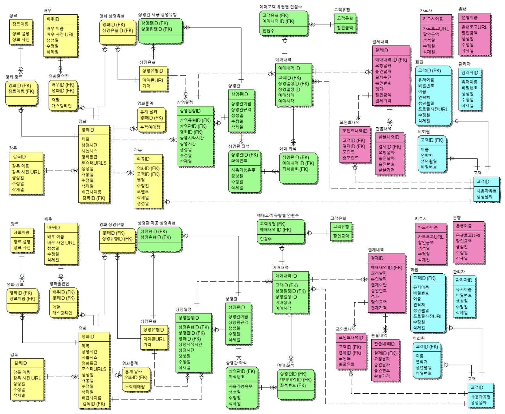

## 목차

  - [핵심 기능 개요](#핵심-기능-개요)
  - [문서 & 참고 자료](#문서-참고-자료)
  - [시스템 아키텍처](#시스템-아키텍처)
  - [기술 스택](#기술-스택)
  - [실행 방법](#실행-방법)
  - [테스트 전략](#테스트-전략)
  - [주요 디렉터리](#주요-디렉터리)
  - [데이터 모델 하이라이트](#데이터-모델-하이라이트)
  - [향후 확장 아이디어](#향후-확장-아이디어)

## UOS Cinema Server

현실의 영화관 운영 절차를 그대로 옮겨온 통합 예매/운영 백엔드입니다. 고객의 예매·결제 경험부터 관리자용 상영 일정, 가격 정책, 제휴 할인 관리까지 한 번에 다루며, 모든 흐름은 `document/` 폴더의 시나리오와 요구사항 문서를 기준으로 구현되었습니다.

### 핵심 기능 개요
- **영화·출연진 관리**: 제목/감독/배우 기반 검색, 개봉일·장르·상영유형 필터, 인기순 정렬. 관리자는 영화 CRUD와 출연진·장르·상영유형을 일괄 편집 가능.
- **예매 여정**: 영화/상영일정 선택 → 고객 유형별 인원 설정 → 좌석 선택 → 결제. 좌석 점유 실패, 청소년 관람불가 등 예외 플로우를 UI에 명확히 노출.
- **결제·포인트**: 카드/계좌 결제와 제휴 할인, 포인트 사용/적립, 환불 정책(잔여 시간별 수수료)을 반영. 해당 내역은 스냅샷 저장으로 데이터 정합성을 보존.
- **상영관·좌석·상영일정**: 상영관/좌석/상영일정 CRUD, 타임테이블 기반 일정 뷰, 수정 불가 일정 표시, 좌석 배치 재구성 지원.
- **고객·어드민**: 회원/비회원 예매 내역 조회, 포인트/회원정보 관리, 회원 탈퇴. 어드민 계정은 별도 권한 체계로 추가/삭제.

### 문서 & 참고 자료
- `document/데이터베이스 설계 최종보고서.docx`: 데이터베이스 설계의 총 과정: 엔티티 타입, 관계, 속성 정의 등 
- `document/Overview.md`: 프로젝트 목적과 설계 철학
- `document/Functional Requirements.md`: API 수준 요구사항
- `document/User Scenario.md`: 화면/플로우 기준 사용자 시나리오
- `document/추가고려사항.md`: 테이블·삭제 정책·레지스트리 패턴 등 설계 의사결정

### ERD


### 시스템 아키텍처
- **Hexagonal Architecture**: `adaptor`(in/out) – `application`(service/port/registry) – `domain` 계층으로 분리, 의존성 역전 구조 유지.
- **Reference Registry 패턴**: 상영 유형, 장르, 고객 유형, 카드사/은행 등 변동이 적은 데이터는 `application/registry`에서 서버 기동 시 1회 로딩 후 메모리 조회.
- **Snapshot 중심 이력 관리**: 예매/결제/환불/포인트 내역은 당시 상태를 문자열·Value Object로 저장하여 원본 데이터 변경 시에도 과거 기록 유지.
- **데이터 삭제 전략**: 멤버·예매 같은 핵심 도메인은 Soft Delete(`deleted_at`) 적용, 게스트 등 단기 데이터는 Hard Delete로 정리.
- **보안/인증**: `core/security`에 JWT 기반 인증, 사용자/관리자 역할 구분, 인터셉터/Argument Resolver로 식별자 주입.

### 기술 스택
- **Backend**: Java 17, Spring Boot, Spring MVC, Spring Security, JPA
- **Database**: Oracle 21c (Testcontainers로 동일 환경 재현)
- **Infra/기타**: Docker, Gradle, StorageConfig(파일 업로드), Custom Registry
- **Frontend**: 별도 레포(React) – 본 저장소는 서버 전용

### 실행 방법
```bash
# 1. 의존성 설치 및 DB 마이그레이션
./gradlew clean build

# 2. 로컬 실행
./gradlew bootRun

# 3. Docker (선택)
docker build -t uos-cinema-server .
docker compose -f scripts/docker-compose.yaml up
```

애플리케이션 설정은 `src/main/resources/application.yml`, 초기 스키마는 `src/main/resources/db/migration`(Flyway)와 `db/data.sql`에 정의되어 있습니다.

### 테스트 전략
- **Acceptance Test**: `src/test/java/.../acceptance` – 사용자 시나리오 단위 End-to-End, Testcontainers로 Oracle 환경 부트.
- **Integration Test**: `integration/` 패키지 – `WebEnvironment.RANDOM`에서 Service ↔ Repository 상호작용 검증.
- **Unit Test**: 서비스 레벨 로직 단위 검증. 필요한 경우 Registry나 Port를 Mocking.
```bash
./gradlew test            # 전체 단위/통합 테스트
./gradlew acceptanceTest  # (필요 시) 시나리오 기반 테스트 태스크
```
- **테스트 컨텍스트 재활용**: 모든 인수/통합 테스트는 `AcceptanceTest`, `IntegrationTest` 추상 클래스를 상속하여 공통 컨텍스트를 공유한다. 인수 테스트는 Testcontainers 기반 Oracle 21c를 사용하고, 통합 테스트는 속도를 위해 H2 임베디드를 활용한다. `DBInitializer`와 `DBInitializeStrategy`(Oracle/H2 전용 구현)를 통해 테스트 전후 테이블 truncate와 초기 데이터를 주입해 격리를 보장한다.

### 주요 디렉터리
```
src/main/java/com/uos/dsd/cinema
 ├─ adaptor
 │   ├─ in/web        # REST Controller & DTO
 │   └─ out           # Persistence, 외부 결제/스토리지 어댑터
 ├─ application
 │   ├─ port          # UseCase & SPI 인터페이스
 │   ├─ service       # 도메인 서비스
 │   └─ registry      # Reference Registry
 ├─ domain            # 엔티티, VO, 도메인 이벤트
 └─ core              # Security, Config, Infra 공통
```

### 데이터 모델 하이라이트
- 고객(Member/Guest)은 `Customers` 테이블로 통합 식별, `type` 컬럼으로 구분하여 예매/결제에서 일관된 FK 사용.
- 예매 좌석/고객 유형은 관계 테이블 + 스냅샷 병행, FK 삭제 시 `ON DELETE SET NULL` 또는 `CASCADE` 전략으로 무결성 유지.
- 영화 통계(누적 예매량)는 `movie.cumulativeBookings` 컬럼으로 캐싱해 인기순 정렬 비용 최소화.

### 향후 확장 아이디어
- 모듈 분리를 통한 MSA 전환(예: 결제/정산 분리) 기반 구축

보다 상세한 플로우나 엣지 케이스는 각 문서를 참고해주세요. README는 전체 구조와 실행 방법의 가이드 역할을 하며, 구현 세부와 시나리오는 `document/` 폴더에서 최신 내용을 확인할 수 있습니다.